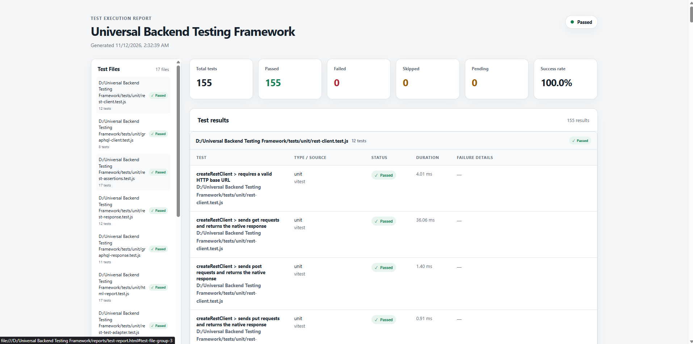

# Universal Backend Testing Framework

A JavaScript testing framework prototype for exercising REST and GraphQL HTTP APIs through reusable clients, adapters, assertions, and a shared test-result model. The project has been validated against a local Shared Table REST backend, PocketBase, a local GraphQL fixture server, and the external Rick and Morty GraphQL API.

This project demonstrates reuse with those tested APIs. It does not claim compatibility with every backend, every authentication scheme, or every GraphQL transport.

## Capabilities

- REST requests using Node.js Fetch: `GET`, `POST`, `PUT`, `PATCH`, and `DELETE`.
- GraphQL JSON-over-HTTP requests using query and mutation operations with variables and custom headers.
- Response normalization and focused REST and GraphQL assertions.
- REST and GraphQL test adapters that convert async callback outcomes to the shared result schema.
- Result collection and heuristic failure analysis.
- Vitest adapter and reporter integration.
- A standalone Node.js script that validates REST requests and collection without importing Vitest.
- Self-contained HTML reports with run summaries, normalized results, and failure analysis.
- Test-file grouping with collapsible groups and sidebar navigation.
- Expandable stack traces and responsive report layout.
- Automatic report opening after local Vitest runs, with configurable output path.

## Architecture

```text
src/
  core/
    contracts/    TestResultSchema
    collection/   ResultCollector
    analysis/     FailureAnalyzer
  adapters/
    rest/         Fetch client, response adapter, assertions, test adapter
    graphql/      Fetch client, response adapter, assertions, test adapter
    vitest/       Vitest result adapter and reporter
tests/
  unit/           Core, REST, GraphQL, and Vitest adapter tests
  integration/    Shared Table, PocketBase, local and external GraphQL checks
  fixtures/       Local GraphQL server and fixture data
  README.md       Test and validation guide
scripts/          Standalone PocketBase Node.js validation
```

### Core Engine

`TestResultSchema` validates a common result shape containing the test identity, name, file, type, source, status, duration, and normalized errors. `ResultCollector` validates and stores each result and attaches failure analysis for each error. Core components do not send network requests.

### REST Adapter

`createRestClient` sends HTTP requests with Node.js Fetch and optional default or request headers. JSON bodies are supported for write methods. `createRestAdapter` parses JSON response bodies where indicated by the media type and records HTTP status, headers, body, parse state, and response time.

Available REST assertions check status, success/failure, JSON parsing, body values and properties, string/array containment, and response headers. `createRestTestAdapter` captures one async callback outcome and submits one normalized result to a collector.

### GraphQL Adapter

`createGraphQLClient` sends query or mutation documents as JSON POST requests. It supports variables and custom headers. `createGraphQLAdapter` normalizes the HTTP response and exposes GraphQL `data` and `errors` when present. It keeps HTTP success separate from GraphQL operation errors.

Available GraphQL assertions check HTTP status and success, data properties and values, and the presence, absence, or message text of GraphQL errors. `createGraphQLTestAdapter` records callback outcomes using the common result schema.

### Vitest and failure analysis

The Vitest adapter maps Vitest outcomes to the shared result contract. The reporter prints structured results to the console and writes a self-contained HTML report after each configured Vitest run. `ResultCollector` validates results and attaches `FailureAnalyzer` classifications and recommendations when available.

The HTML report includes run summary cards, individual test results, collapsible groups based on each result's source file, and a file navigation sidebar. Failure details are visible in each failed result; full stack traces remain in their own expandable sections. The report uses a responsive layout and opens in the default browser after local runs when a graphical environment is available. Browser opening is skipped in CI and headless environments.

The default report path is `reports/test-report.html`. Set `UBTF_HTML_REPORT_PATH` to choose another output path, or set `UBTF_OPEN_HTML_REPORT=false` to disable automatic browser opening. Generated reports are ignored by Git.

#### HTML report preview



To generate a report for the failure examples, run:

```bash
node scripts/html-error-demo.js
```

This writes `reports/error-demo-report.html` without adding intentional failures to the regular Vitest suite. Open either generated report directly in a browser if needed.

The standalone PocketBase validation is a separate script:

```bash
node scripts/pocketbase-standalone-validation.js
```

It exercises the REST components against the local PocketBase service; see [tests/README.md](tests/README.md) for its requirements.

`FailureAnalyzer` uses message and error-name patterns to classify assertion, property-access, range, reference, syntax, and aggregate errors. It also has an `unknown` fallback. These are heuristic diagnostic clues, not proof of a root cause.

## Setup

Use a Node.js version supported by the locked Vitest toolchain and with built-in Fetch support (Node 20.19+ or Node 22.12+ is a suitable baseline for this lockfile).

```bash
npm ci
```

No project `.env` file is required for the documented checks. The local Shared Table integration needs its separate backend and PostgreSQL environment configured in that backend project.

## Running tests

See [tests/README.md](tests/README.md) for prerequisites, exact commands, service requirements, expected results, and standalone validation details.

### Unit tests and reporter integration

```bash
npm test
```

The root Vitest configuration includes all `tests/unit/**/*.test.js` files and `tests/integration/reporter.integration.test.js`.

### Integration suites

Run each integration suite separately so service requirements are explicit:

```bash
npx vitest run --config vitest.integration.config.js
npx vitest run --config vitest.graphql.integration.config.js
npx vitest run --config vitest.pocketbase.integration.config.js
npx vitest run --config vitest.rick-and-morty.integration.config.js
```

| Suite | Requirements |
|---|---|
| Shared Table REST | Backend at `http://localhost:3000/api`, PostgreSQL connection and expected tables configured in the Shared Table project. Creates unique test records and attempts cleanup. |
| Local GraphQL | No external backend. The test creates a local fixture server on an ephemeral port. |
| PocketBase REST | PocketBase at `http://127.0.0.1:8090`, with the public `products` collection and the fields used by the test. Creates and deletes its test record. |
| Rick and Morty GraphQL | Internet access and availability of `https://rickandmortyapi.com/graphql`. Queries public data and does not mutate it. |

### Standalone Node.js validation

```bash
node scripts/pocketbase-standalone-validation.js
```

This script requires the same local PocketBase service and collection as the PocketBase integration test. It uses the framework's REST client, adapter, assertions, test adapter, schema, and collector. It prints a summary and collected results. One intentional assertion failure is included to demonstrate the `assertion_failure` analysis category; this is expected behavior, not a failed validation run.

## Latest verified test run

The current default `npm test` suite passed **155/155 tests across 17 test files**. This run includes unit tests and the reporter integration test configured in `vitest.config.js`; it does not include the four backend integration suites. Those suites have separate commands and external requirements documented in [tests/README.md](tests/README.md). Their results are not reported here because they were not run as part of this latest verification.

## Current limitations

- The framework is a set of reusable components and adapters; it does not provide a general test discovery or command-line runner of its own. Vitest runs the test suites, while the standalone script is a specific PocketBase validation.
- REST support is focused on standard HTTP methods and JSON request/response bodies. Multipart uploads and streaming are not covered by the current adapter.
- GraphQL support uses JSON POST over HTTP. Subscriptions and other transports such as WebSocket are not implemented.
- Authentication can be supplied with headers, but the framework does not implement a universal login or token-refresh flow.
- Assertions are explicit helpers rather than generated API contracts or schema discovery.
- Failure analysis is heuristic. Persistent JSON reports, coverage collection, CI workflows, and secret redaction are not implemented.
- `package.json` names `index.js` as its `main` entry, but the repository currently has no root `index.js`. The source modules can be imported by their file paths; a package-level entry point has not been established.
- The package is marked `private`, so the current metadata does not permit npm publication.

Older planning documents are retained locally as project history and are excluded from the publication file list.
